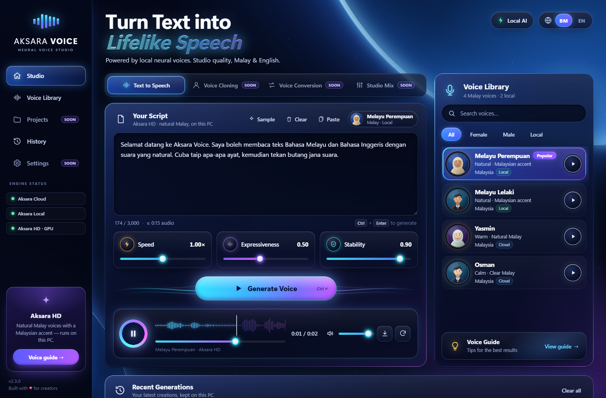
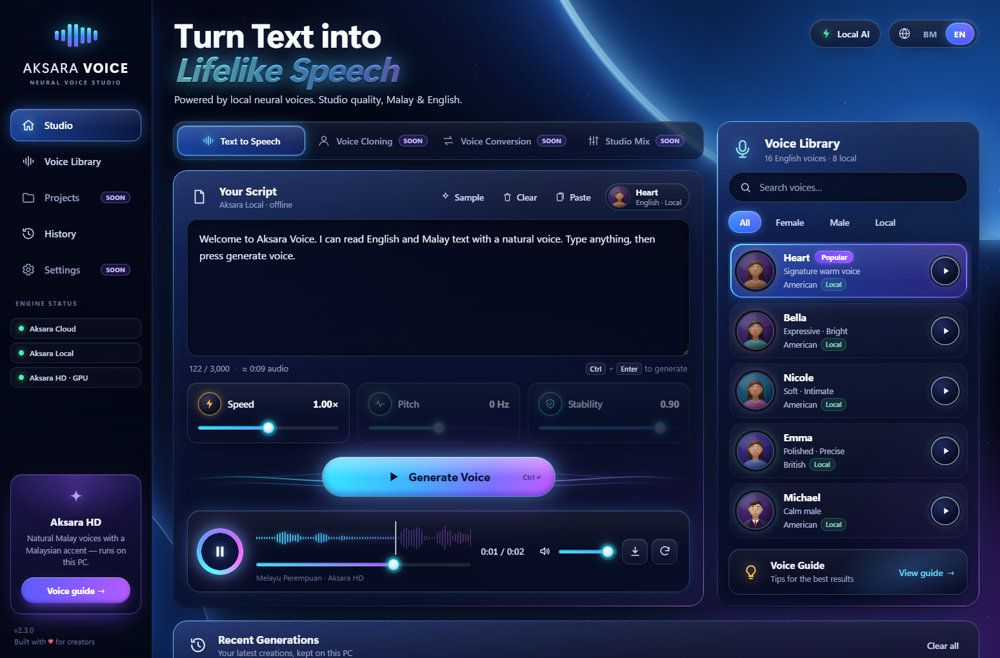
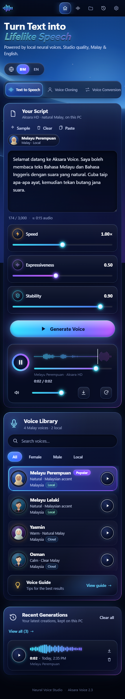

# Aksara Voice — neural voice studio

A local text-to-speech studio for **Bahasa Melayu and English**. Type text, choose a voice, generate,
listen and download — everything runs on your own PC except the optional cloud voices.

- **Aksara HD** — natural, conversational Malay from a local multilingual neural model.
- **Aksara Local** — lightweight English voices that run offline.
- **Aksara Cloud** — optional online voices for Malay and English (internet required).
- No account, no API key, no subscription.







## Features

- **Two languages** — switch BM/EN with one click; the library, sample text and voices follow.
- **20 voices** with language, accent, gender and local/cloud labels.
- **Natural Malay** — two Aksara HD voices (female and male) guided by Malaysian reference clips.
- **Instant previews** — press play on any voice card before generating.
- **Expressiveness + stability** for Aksara HD, plus speed and pitch for Aksara Cloud voices.
- **Studio UI** — neon rail navigation, a focused script panel, portrait voice cards and recent generations.
- **Waveform player** with seek, play/pause, download and regenerate.
- **History** of every generation, stored on disk; replay and download after a reload.
- **WAV** from the local engines, **MP3** from Aksara Cloud.
- **Responsive** studio layout for desktop, tablet and phone.

## Voices and engines

| Engine | Languages | Voices | Where it runs |
|---|---|---|---|
| **Aksara HD** | Malay | Melayu Perempuan, Melayu Lelaki | This PC (GPU if available, otherwise CPU); model ~3 GB |
| **Aksara Local** | English | Heart, Bella, Nicole, Emma, Michael, Onyx, George, Lewis | This PC's CPU (offline); model ~350 MB |
| **Aksara Cloud** | Malay + English | Yasmin, Osman + 8 English accents | A third-party online speech service (internet required) |

**Aksara HD is the default for Malay.** Its two voices are guided by short Malaysian reference clips,
which keeps the pronunciation and accent Malaysian while the model supplies natural prosody.
Aksara Cloud's Malay voices remain as a fast fallback for long text.

## Run

First create the Python 3.12 environment and download the models (see *Setup* and *Model files*
below). Then, from the project folder:

```powershell
.venv\Scripts\python.exe app.py
```

The easiest way: create the one-click shortcuts once with
`powershell -ExecutionPolicy Bypass -File tools\make_shortcuts.ps1`, then double-click
**`Start Aksara Voice`** (the shortcut with the neon sound-bar icon in the project folder). It starts
the server in the background, waits until it answers and opens **http://127.0.0.1:7788**. If the
studio is already running it just opens the browser, and if an **older version** is still running (the
code was updated) it restarts it automatically. **`Stop Aksara Voice`** stops the server. Server output
goes to `logs\server.log` / `logs\server.err.log`. Only a process that listens on the studio port *and*
answers `/api/health` as Aksara Voice is ever stopped.

To put the two buttons on the Desktop too (or recreate them after moving the folder):

```powershell
powershell -ExecutionPolicy Bypass -File tools\make_shortcuts.ps1 -Desktop
```

You can also double-click **`start-aksara.bat`** (runs in a visible console window). If the studio is
already running, the batch file (and `app.py`) just opens the browser instead of starting a second
copy; if another program owns the port, it says so (use `app.py --port 7790`). `start-aksara.bat` only
uses `.venv` — never the global Python.

### Setup (new machine / rebuilt venv)

`pip install -r requirements.txt` on an empty venv **fails on purpose**: one engine package declares
`numpy<2` while another needs `numpy>=2`. Install in this order (Python 3.12):

```powershell
py -3.12 -m venv .venv
.venv\Scripts\python.exe -m pip install torch==2.6.0 torchaudio==2.6.0 --index-url https://download.pytorch.org/whl/cpu
.venv\Scripts\python.exe -m pip install chatterbox-tts==0.1.7
.venv\Scripts\python.exe -m pip install edge-tts==7.3.1 kokoro-onnx==0.6.1 mutagen==1.48.1 setuptools==80.9.0
.venv\Scripts\python.exe -m pip install numpy==2.4.2 --no-deps
```

`pip check` then reports only the known `numpy<2` note; everything runs on numpy 2.4.2. Do not upgrade
torch/numpy/setuptools without re-testing both local engines (`pytest -m ui` generates with both).

### Tests

```powershell
.venv\Scripts\python.exe -m pip install -r requirements-dev.txt   # pytest + playwright, no torch/numpy changes
.venv\Scripts\python.exe -m pytest            # unit + API tests (~15 s, Aksara HD off, temp data folder)
.venv\Scripts\python.exe -m pytest -m ui      # browser smoke test with the installed desktop browser (~1 min)
.venv\Scripts\python.exe tools\check_voices.py --settings   # every voice on the running studio (no history)
```

`tools/check_voices.py` generates a sentence with every voice (and min/max settings per engine) on the
running studio with `save=false`, decodes the audio and checks duration, loudness and silence.

Every test starts its own server on a free port with a temporary `VOX_DATA_DIR`, so your
`data/history.json` and `data/audio` are never touched. `VOX_DISABLE_ENGINES=chatterbox,kokoro,edge`
skips loading engines (used by the fast tests).

### Model files

Aksara HD needs its model files in `models/chatterbox` (~3 GB):

```powershell
.venv\Scripts\python.exe tools\download_chatterbox.py
.venv\Scripts\python.exe tools\make_malay_references.py
```

The downloader uses plain HTTPS byte ranges. Each range is kept in `<file>.rangeN`, so Ctrl+C or a
dropped connection is safe: run it again and only the missing bytes are fetched. Files are moved into
place only after the size and the published SHA-256 match; files that already exist with the right
size are skipped. Options: `--only ve.pt`, `--workers 4`, `--out <folder>`, `--no-verify`.
`make_malay_references.py` builds the two Malaysian reference clips (retries with backoff, clear
errors, `--force` to rebuild existing clips).

Aksara Local needs two files in `models/kokoro` (~350 MB):

```powershell
.venv\Scripts\python.exe tools\download_kokoro.py
```

The paths are configurable in `config.json` (`kokoro_model`, `kokoro_voices`, `chatterbox_dir`).
Without the model files the matching voices are hidden; the other engines still work.

### CPU and GPU

With **CUDA PyTorch (2.6.0+cu124)** and a CUDA-capable GPU with ~3.5 GB free VRAM, Aksara HD runs
faster than real time (measured on a 6 GB laptop GPU: a 1,601-character script, 90 s of audio, in
~71 s). On a modern laptop CPU the same takes ~3.3x the audio length. The **Aksara HD** pill shows
`GPU` or `CPU`; when the GPU has less than ~3.3 GB free (for example another local AI app has loaded a
large model) Aksara Voice falls back to the CPU automatically.

To install CUDA PyTorch into the venv:

```powershell
.venv\Scripts\python.exe -m pip install --no-deps --force-reinstall torch==2.6.0 torchaudio==2.6.0 --index-url https://download.pytorch.org/whl/cu124
```

## How to use

1. Pick **Bahasa Melayu** or **English**.
2. Choose a voice in the library (press its small play button to preview).
3. Type or paste text — up to **3,000 characters**.
4. For Aksara HD, tune **Expressiveness** (0.20–0.90) and **Stability**. For Aksara Cloud, use speed and pitch.
5. Press **Generate voice** (`Ctrl`/`Cmd` + `Enter`). The button shows the elapsed time
   (`Generating… 12s`) and, for slower voices, an estimate; **Cancel** stops the request. A cancelled
   generation is not saved to history, and the server stops between sentences.
6. Listen, seek on the waveform, download, or generate again.
7. Every generation appears under **Recent generations** and survives a reload.

The **Sample** button inserts a sample in the current language. **Paste** reads the clipboard; if the
browser blocks that, it focuses the editor so `Ctrl+V` works. **Clear** empties the editor.

- Long text on **Aksara HD (CPU)** (over ~300 characters) shows an estimate and a one-click switch to
  the matching Aksara Cloud voice, which is much faster.
- The **Female / Male / Local** filters never hide the selected voice silently: a hidden selection is
  switched to the first visible voice (with a message), and a search shows a "Show all" note.
- Volume and mute are remembered in the browser.
- Keyboard: `Ctrl`+`Enter` generate · `Esc` stop preview/playback · `Space` play/pause when focus is
  not on a control · `Tab` reaches every control (visible focus ring).
- Voice Cloning, Voice Conversion, Studio Mix, Projects and Settings are marked **Soon** and are not
  active yet.

## API

All endpoints are local to `127.0.0.1:7788`.

| Method | Path | Purpose |
|---|---|---|
| GET | `/api/catalog` | voices, engines, defaults, character limit |
| GET | `/api/history?limit=30` | recent generations |
| POST | `/api/tts` | `{text, voice, speed, pitch, exaggeration, stability, save}` → audio |
| POST | `/api/history/delete` | `{id}` |
| POST | `/api/history/clear` | remove all generations |
| GET | `/audio/<id>.mp3` / `.wav` | audio file (supports Range requests) |

`POST /api/tts` returns audio bytes and metadata headers: `X-Duration`, `X-Gen-Seconds`, `X-Voice`,
`X-Voice-Name`, `X-Engine`, `X-Lang`, `X-Ext`, and, when saved, `X-History-Id` and `X-Audio-Url`.

Validation (all errors are JSON `{"error": "..."}`, never a traceback):

| Field | Rule |
|---|---|
| `text` | string, not empty, at most `max_chars` after whitespace clean-up |
| `voice` | an id from `/api/catalog` |
| `speed` | number 0.7–1.3 (default 1.0) |
| `pitch` | number −20–20 Hz, Aksara Cloud only (default 0) |
| `exaggeration` | number 0.2–0.9, Aksara HD only (default 0.5) |
| `stability` | number 0–1, Aksara HD only (default 0.5) |
| `save` | `true`/`false` (default `true`) |

Status codes: `400` invalid JSON/field, `403` cross-site request or non-local `Host`, `404` unknown
path/voice file, `405` other methods, `411` missing `Content-Length`, `413` body over 256 KB,
`415` body not `application/json`, `503` engine not ready. `GET`/`HEAD /audio/<file>` serve only plain
`*.wav`/`*.mp3` names inside `data/audio` and support single byte ranges (`bytes=0-99`, `bytes=100-`,
`bytes=-500`).

## Data and privacy

- `data/history.json` — generation metadata.
- `data/audio/` — generated audio files. The last **60** are kept.
- **Aksara HD** and **Aksara Local** run entirely on this PC.
- **Aksara Cloud** sends your text to a third-party online speech service. It needs internet. Use the
  local voices for anything private.
- The server binds to `127.0.0.1` only; a non-loopback `host` in `config.json` is ignored with a
  warning. Requests with a foreign `Host` header (DNS rebinding) or from another website (`Origin`)
  are refused, so a web page you visit cannot clear your history or use the studio.

## Configuration

| Key | Meaning |
|---|---|
| `host` / `port` | local address and port (default `127.0.0.1:7788`) |
| `max_chars` | maximum text length (default 3000) |
| `history_limit` | how many generations to keep (default 60) |
| `kokoro_model` / `kokoro_voices` | paths to the Aksara Local model files |
| `chatterbox_device` | Aksara HD device: `auto`, `cuda`, or `cpu` |
| `chatterbox_dir` | folder containing the Aksara HD model files |
| `default_voice_ms` | default Malay voice |
| `default_voice_en` | default English voice |

## Notes and limits

- This is a text-to-speech studio. There is no user-upload voice cloning yet; the two built-in
  Aksara HD voices use short Malaysian reference clips (synthetic demo audio, not recordings of a
  real person).
- **Aksara Cloud** relies on an unofficial client for a free online service. Availability and rate
  limits are outside this project's control and can change; check that service's terms before using
  it in a commercial product.
- The English local engine has no Malay voice; Malay is Aksara HD (local) or Aksara Cloud.
- Long text is split into sentences and generated sequentially; on a CPU, Aksara HD is noticeably
  slower than the cloud voices.
- Aksara HD output carries the engine's built-in inaudible watermark (responsible-AI default).

## Project structure

```
aksara-voice/
  app.py                  local HTTP server + API
  tts_engine.py           the three engines, voice catalog, history
  config.json             port, model paths, defaults
  requirements.txt        pinned versions (install order: see Setup)
  requirements-dev.txt    pytest + playwright (tests only)
  pytest.ini
  start-aksara.bat        start in a console window
  tests/                  unit, API and browser smoke tests
  tools/
    download_chatterbox.py  Aksara HD model files
    download_kokoro.py      Aksara Local model files
    make_malay_references.py
    aksara-launcher.ps1     start / stop / restart used by the shortcuts
    make_shortcuts.ps1      (re)creates the shortcuts, -Desktop for the Desktop
    make_icon.py            draws tools/aksara.ico
    check_voices.py         checks every voice of a running studio
  web/                    index.html · style.css · app.js · favicon.svg
  models/                 model weights + Malaysian reference clips (not committed)
  data/                   history.json + generated audio (not committed)
  docs/                   screenshots
```

## Third-party software

Aksara Voice is an independent project. It is **not affiliated with, endorsed by or sponsored by** the
authors of the packages, models or online services it uses. It depends on these open-source Python
packages, installed separately with `pip`, each under its own license:

| Package | Used for | License |
|---|---|---|
| [`chatterbox-tts`](https://pypi.org/project/chatterbox-tts/) | Aksara HD engine | MIT |
| [`kokoro-onnx`](https://pypi.org/project/kokoro-onnx/) | Aksara Local engine | MIT (model weights: Apache-2.0) |
| [`edge-tts`](https://pypi.org/project/edge-tts/) | Aksara Cloud client | see its package page |
| [`torch`](https://pypi.org/project/torch/), `torchaudio`, `numpy`, `mutagen` | runtime | see their package pages |

Model files are downloaded by the scripts in `tools/` from their public release pages and are not
redistributed in this repository.

## License

The Aksara Voice code in this repository (server, UI, tools and tests) is released under the
[MIT License](LICENSE). Third-party packages, models and online services keep their own terms.
